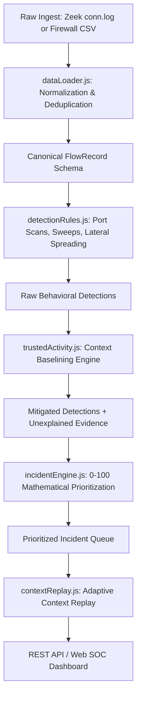

# Sentinel AI: System Architecture & Design Guide

## 1. System Overview
**Sentinel AI** is a modular Network Traffic Anomaly & Behaviour Analysis platform designed for Security Operations Centers (SOCs). It features adaptive contextual baselining, dual-schema log normalization, evidence-preserving false-positive reduction, and an analyst-centric **Adaptive Context Replay** mechanism.

---

## 2. Directory Layout
The project is strictly separated into modular, beginner-friendly components:

```
Sentinel-AI/
├── backend/                  # Detection engine & REST API service
│   ├── app/
│   │   ├── types.js          # Canonical FlowRecord & SOC severity types
│   │   ├── dataLoader.js     # RFC-4180 CSV parser & column-mapping normalizer
│   │   ├── detectionRules.js # Volumetric & behavioral anomaly rules
│   │   ├── trustedActivity.js# Context baselining & FP reduction
│   │   ├── incidentEngine.js # Threat actor clustering & 0-100 scoring
│   │   ├── contextReplay.js  # Adaptive Context Replay engine
│   │   ├── evaluation.js     # Precision, recall, FPR, F1-score evaluation
│   │   └── pipeline.js       # Orchestration pipeline
│   ├── main.js               # REST API server (ports 3001, /health, /api/*)
│   ├── runAnalysis.js        # Offline CLI analysis & report generator
│   └── package.json          # Backend-specific package scripts
├── frontend/                 # SOC Analyst Dashboard web interface
│   ├── src/
│   │   ├── components/       # MetricsBanner, IncidentQueue, ContextReplay, EvidenceTable, UploadModal
│   │   ├── services/         # api.js API client
│   │   ├── styles/           # Dark mode glassmorphic CSS
│   │   ├── types/            # Frontend data types & schemas
│   │   └── main.js           # Frontend application controller
│   ├── public/               # Static assets
│   ├── index.html            # Main dashboard HTML entry point
│   ├── server.js             # Frontend static dev server (port 5173)
│   └── package.json          # Frontend-specific package scripts
├── config/                   # Externalized JSON baselines & mappings
│   ├── config.json           # Approved scanners, backups, maintenance, patch servers
│   └── dataset_mapping.json  # Column definitions for Zeek and Firewall schemas
├── datasets/                 # Sanitized & synthetic flow telemetry
│   ├── original/             # Original header specifications and documentation
│   └── synthetic/            # Annotated datasets with ground truth labels
├── tests/                    # Comprehensive automated test suite
│   ├── backend/              # Mapper, detection rules, and context tests
│   ├── integration/          # Pipeline and dynamic configuration tests
│   └── frontend/             # REST API contracts and endpoint tests
├── docs/                     # Technical documentation
│   ├── ARCHITECTURE.md       # Architecture & component guide (this document)
│   ├── DATASET_MAPPING.md    # Dual-schema normalization guide
│   ├── EVALUATION_REPORT.md  # Empirical precision/recall/FPR benchmark
│   └── LIMITATIONS.md        # Real-world engineering boundaries
├── README.md                 # Quickstart guide & commands
├── .gitignore                # Version control exclusions
└── package.json              # Root orchestration scripts
```

---

## 3. Data Processing Pipeline



### Stage 1: Log Normalization Layer
- Translates disparate column names from Zeek (`id.orig_h`, `id.resp_p`, `orig_bytes`) and Enterprise Firewall (`src_ip`, `dst_port`, `bytes_sent`) into unified `FlowRecord` objects.
- Suppresses byte-identical duplicate rows while indexing deduplication metrics in audit logs.
- Sanitizes missing ports, bytes, and timestamp formats with non-crashing safe defaults.

### Stage 2: Detection Rules
1. **Vertical Port Scan (`RULE-PORT-SCAN-001`)**: Single source probing $\ge N$ distinct destination ports across target host(s) within a sliding time window (default: 60s).
2. **Horizontal Network Sweep (`RULE-NET-SWEEP-002`)**: Single source probing identical service port(s) across $\ge M$ distinct hosts within a sliding time window (default: 60s).
3. **Lateral Movement / Spreading (`RULE-LAT-MOVE-003`)**: Host receiving administrative connections (SMB 445, RDP 3389, SSH 22, WinRM 5985) subsequently fanning out to multiple internal hosts on administrative ports.

### Stage 3: Evidence-Preserving False-Positive Reduction
- Inspects `approved_security_scanners`, `large_nightly_backups`, `patch_servers`, and `maintenance_windows`.
- Applies transparent percentage mitigations to verified operational lookalikes.
- **Evidence Preservation Guarantee**: No alert or flow record is pruned or discarded. Benign lookalikes remain in the queue under the `INFORMATIONAL / BENIGN_LOOKALIKE` tier for full compliance auditability.
- **Unexplained Evidence Retention**: If an approved host accesses undeclared ports or operates outside scheduled windows, the system flags the deviation and prevents suppression.

### Stage 4: Transparent 0–100 Prioritization Formula
$$\text{Score} = \min(100, \max(5, \text{Base Adjusted Score} + \text{Correlation Bonus} + \text{HVA Proximity} + \text{Unexplained Deviation Penalty}))$$
- **Base Adjusted Score**: Highest single detection score from actor after contextual mitigation.
- **Multi-Rule Correlation Bonus**: $+15$ points per additional distinct attack behavior (e.g., Port Scan + Lateral Movement).
- **High-Value Asset (HVA) Proximity**: $+15$ points if targeting Domain Controllers or Key Database servers.
- **Unexplained Deviation Penalty**: $+15$ to $+20$ points if profile violation occurred.
