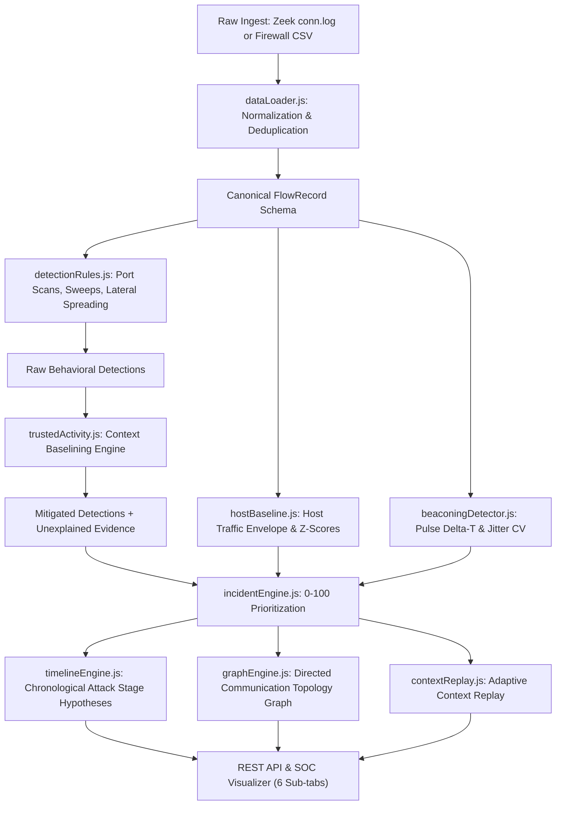

# Sentinel AI: System Architecture & Design Guide

## 1. System Overview
**Sentinel AI** is a modular Network Traffic Anomaly & Behaviour Analysis platform designed for Security Operations Centers (SOCs). It features adaptive contextual baselining, dual-schema log normalization, evidence-preserving false-positive reduction, candidate beaconing detection, host baseline deviation envelopes, chronological attack timelines with stage hypotheses, interactive communication graphs, and an analyst-centric **Adaptive Context Replay** mechanism.

---

## 2. Directory Layout
The project is strictly separated into modular, beginner-friendly components:

```
Sentinel-AI/
├── backend/                  # Detection engine & REST API service
│   ├── app/
│   │   ├── types.js          # Canonical FlowRecord & SOC severity types
│   │   ├── dataLoader.js     # RFC-4180 CSV parser & column-mapping normalizer
│   │   ├── detectionRules.js # Volumetric & behavioral anomaly rules
│   │   ├── trustedActivity.js# Context baselining & FP reduction
│   │   ├── hostBaseline.js   # Host traffic baseline & deviation engine (Z-scores)
│   │   ├── beaconingDetector.js# Periodic C2 beaconing & interval pulse detector
│   │   ├── timelineEngine.js # Chronological timeline & attack-stage hypotheses
│   │   ├── graphEngine.js    # Directed communication topology graph engine
│   │   ├── incidentEngine.js # Threat actor clustering & 0-100 scoring
│   │   ├── contextReplay.js  # Adaptive Context Replay engine
│   │   ├── evaluation.js     # Precision, recall, FPR, F1-score evaluation
│   │   └── pipeline.js       # Orchestration pipeline
│   ├── main.js               # REST API server (port 3001, /health, /api/*)
│   ├── runAnalysis.js        # Offline CLI analysis & report generator
│   └── package.json          # Backend-specific package scripts
├── frontend/                 # SOC Analyst Dashboard web interface
│   ├── src/
│   │   ├── components/       # SvgCharts, InvestigationScreen, ContextReplay, Dashboard, etc.
│   │   ├── services/         # api.js API client
│   │   ├── styles/           # Dark teal glassmorphic styles.css
│   │   ├── types/            # Frontend data types & schemas
│   │   └── main.js           # Frontend application controller
│   ├── public/               # Static assets
│   ├── index.html            # Main dashboard HTML entry point
│   ├── server.js             # Frontend static dev server (port 5173)
│   └── package.json          # Frontend-specific package scripts
├── config/                   # Externalized JSON baselines & mappings
│   ├── config.json           # Approved scanners, backups, maintenance, patch servers
│   └── dataset_mapping.json  # Column definitions for Zeek and Firewall schemas
├── datasets/                 # Sanitized & synthetic flow telemetry
│   ├── original/             # Original header specifications and documentation
│   └── synthetic/            # Annotated datasets with ground truth labels
├── tests/                    # Comprehensive automated test suite (29/29 passing)
│   ├── backend/              # hostBaseline, beaconing, timelineAndGraph, detection, etc.
│   ├── integration/          # Pipeline and dynamic configuration tests
│   └── frontend/             # REST API contracts and endpoint tests
├── docs/                     # Technical documentation
│   ├── ARCHITECTURE.md       # Architecture & component guide (this document)
│   ├── DATASET_MAPPING.md    # Dual-schema normalization guide
│   ├── EVALUATION_REPORT.md  # Empirical precision/recall/FPR benchmark
│   └── LIMITATIONS.md        # Real-world engineering boundaries
├── README.md                 # Quickstart guide & commands
├── .gitignore                # Version control exclusions
└── package.json              # Root orchestration scripts
```

---

## 3. Data Processing & Visualization Pipeline



### Stage 1: Log Normalization Layer
- Translates disparate column names from Zeek (`id.orig_h`, `id.resp_p`, `orig_bytes`) and Enterprise Firewall (`src_ip`, `dst_port`, `bytes_sent`) into unified `FlowRecord` objects.
- Suppresses byte-identical duplicate rows while indexing deduplication metrics in audit logs.
- Sanitizes missing ports, bytes, and timestamp formats with non-crashing safe defaults.
- Fallback logic calculates `total_bytes = bytes_out + bytes_in` or preserves raw `total_bytes` from enterprise logs.

### Stage 2: Volumetric & Behavioral Detection Rules
1. **Vertical Port Scan (`RULE-PORT-SCAN-001`)**: Single source probing $\ge N$ distinct destination ports across target host(s) within a sliding time window (default: 60s).
2. **Horizontal Network Sweep (`RULE-NET-SWEEP-002`)**: Single source probing identical service port(s) across $\ge M$ distinct hosts within a sliding time window (default: 60s).
3. **Lateral Movement / Spreading (`RULE-LAT-MOVE-003`)**: Host receiving administrative connections (SMB 445, RDP 3389, SSH 22, WinRM 5985) subsequently fanning out to multiple internal hosts on administrative ports.

### Stage 3: Statistical Host Baseline & Traffic Deviation (`hostBaseline.js`)
- **Metrics Tracked**: Flow count, byte volume, distinct destination hosts, distinct destination ports, protocol distributions, and connection frequency.
- **Temporal Baselining**: Activity is partitioned into historical windows.
- **Zero Label Leakage**: Baselines are established strictly from observable telemetry metrics; ground-truth annotations are never leaked into baseline calculations.
- **Insufficient History Handling**: If a host has fewer than 3 historical observation windows, status is explicitly set to `INSUFFICIENT_HISTORY` rather than raising a false alarm.
- **Statistical Deviation**: Evaluates observed metrics against learned normal mean ($\mu$) and standard deviation ($\sigma$):
  $$Z = \frac{X - \mu}{\sigma}, \quad \text{Deviation } \% = \frac{X - \mu}{\mu} \times 100$$
- **Operational Alignment**: Large volumetric bursts by scheduled backup servers during authorized maintenance windows are flagged as `BENIGN_SCHEDULED_BACKUP` and mitigated.

### Stage 4: Candidate Beaconing & Interval Pulse Detector (`beaconingDetector.js`)
- Evaluates repeated connections grouped by `(src_ip, dst_ip, dst_port)`.
- Calculates inter-arrival intervals $\Delta t_i = t_{i} - t_{i-1}$.
- Computes mean interval ($\mu$), median interval ($\tilde{\mu}$), standard deviation ($\sigma$), and Coefficient of Variation jitter:
  $$CV = \frac{\sigma}{\mu}$$
- Classifies candidate channels:
  - $CV \le 0.20$: Highly periodic, low-jitter automated communication (characteristic of automated C2 beaconing).
  - $0.20 < CV \le 0.50$: Moderate jitter beaconing.
  - $CV > 0.50$: Irregular human-driven or non-malicious intermittent traffic.
- **Service Disambiguation**: Standard system synchronization (NTP UDP/123, domain controller heartbeats, security sensor polling) is disambiguated and classified as `LEGITIMATE_SYSTEM_SYNC`.

### Stage 5: Chronological Attack Timeline & Stage Hypotheses (`timelineEngine.js`)
- Arranges incident flows in strict chronological sequence with delta timestamps relative to the initial connection ($T+0s, T+\Delta t$).
- Infers evidence-backed attack-stage hypotheses:
  - **Reconnaissance**: Fast multi-port or multi-host scanning flows.
  - **Lateral Movement**: Fan-out connections to internal subnets across administrative ports (445, 3389, 22, 5985).
  - **Command and Control (C2)**: Periodic low-jitter egress channels to external destinations.
  - **Unusual Outbound Transfer**: High-volume egress to external IPs.
  - **Unclassified**: General telemetry flows that do not match specialized attack stages.
- **Hypothesis Disclaimer Guarantee**: The visualizer and reports prominently display that stage classifications are evidence-backed hypotheses to accelerate triage, not forensically proven ground-truth.

### Stage 6: Directed Communication Topology Graph (`graphEngine.js`)
- Constructs node-link topology representing communicating hosts and traffic flows.
- Nodes represent internal workstations, servers, domain controllers, scanners, and external endpoints.
- Directed edges represent traffic flow direction with edge thickness scaled logarithmically or linearly to transmitted byte volume.
- Suspicious channels and compromised source hosts are highlighted with alert indicators.
- Interactive inspector allows SOC analysts to click any node or link to view port lists, protocol breakdown, and data volume.

### Stage 7: Evidence-Preserving False-Positive Reduction (`trustedActivity.js`)
- Inspects `approved_security_scanners`, `large_nightly_backups`, `patch_servers`, and `maintenance_windows`.
- Applies transparent percentage mitigations to verified operational lookalikes.
- **Evidence Preservation Guarantee**: No alert or flow record is pruned or discarded. Benign lookalikes remain in the queue under the `INFORMATIONAL / BENIGN_LOOKALIKE` tier for full compliance auditability.
- **Unexplained Evidence Retention**: If an approved host accesses undeclared ports or operates outside scheduled windows, the system flags the deviation and prevents suppression.

### Stage 8: Transparent 0–100 Prioritization Formula (`incidentEngine.js`)
$$\text{Score} = \min(100, \max(5, \text{Base Adjusted Score} + \text{Correlation Bonus} + \text{HVA Proximity} + \text{Unexplained Deviation Penalty}))$$
- **Base Adjusted Score**: Highest single detection score from actor after contextual mitigation.
- **Multi-Rule Correlation Bonus**: $+15$ points per additional distinct attack behavior.
- **High-Value Asset (HVA) Proximity**: $+15$ points if targeting Domain Controllers or Key Database servers.
- **Unexplained Deviation Penalty**: $+15$ to $+20$ points if profile violation occurred.
- Seamlessly integrates host deviations and beaconing findings without double-counting.

---

## 4. SOC Analyst Interface Sub-Tabs
Inside the right detail inspector of `InvestigationScreen.js`, analysts toggle between 6 specialized views:
1. **Overview & Rules**: Score breakdown audit, triggered rules (observed vs configured threshold), and actionable playbooks.
2. **Baseline & Deviation**: Learned normal baseline envelope vs observed telemetry, Z-scores, and deviation percentages.
3. **Beaconing & Intervals**: Inter-connection interval pulse chart, jitter CV, repetitions, duration, and C2 classification.
4. **Attack Timeline**: Chronological milestone track with delta timestamps, stage badges, and hypothesis disclaimer.
5. **Network Graph**: Directed communications graph with host nodes, weighted edges, and topology inspector.
6. **Flow Evidence**: Preserved network flow records table with one-click clipboard copying.
